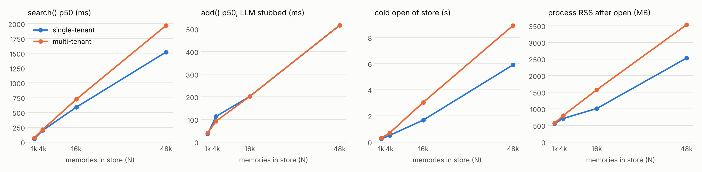

# mem0 本地 Agent 全链路延迟剖析（Profiling Report v1）

> 目的：在**全本地**（无云 API）环境下，跑一个带长期记忆的对话 agent（mem0 + 本地 LLM），
> 对每一层、每一步记录时延 / CPU / I/O，搞清楚时间到底花在哪、和硬件资源是什么关系，
> 为后续“硬件感知的 agent memory 系统”找切入点。新颖性调研见 [`related_work.md`](related_work.md)。

## 0. TL;DR

1. **写路径（`mem0.add`）是绝对瓶颈**：稳态每轮 44.6 s 中 `add` 占 41.4 s（93%）；读路径（检索）只要 **40 ms**，回答生成 3.2 s。
2. `add` 的时间 **>99.7% 在 LLM 抽取调用里**；embedding、spaCy、向量库、SQLite 加起来约 **100 ms**。
3. 抽取调用的根源是 **mem0 2.2.1 的抽取 system prompt 约 8k token（33.6 KB），而且每次 `add` 都要带上**：
   - 不开 prefix cache：每次 add 的 prefill 是 **59.9 s**（8356 token，140 tok/s）；
   - 开 prefix cache（命中 91.5%）：prefill 降到 **8.7 s**（6.9×），但剩下约 740 个新 token 要对 8k 的缓存做 attention，只能跑 **85 tok/s**（短上下文是 250 tok/s）；
   - decode 在 8k 上下文下只有 **11.6 tok/s**（短上下文是 22.6 tok/s），而 mem0 要求输出“15–80 词/条”的 JSON，平均 **376 个输出 token** → **decode 32.5 s 成为最大单项**。
4. **这段静态前缀的 KV 约 230 MB/份**（Qwen2.5-1.5B，F16 KV）。llama-server 默认会把空闲 slot 的 KV 存到主机内存（`--cache-ram 8192`），所以单 slot 时依然能命中——**现成推理引擎里已经有一层“KV 在 slot↔DRAM 之间分层”**，记忆系统完全没有意识到并利用它。
5. **把写路径异步化在单机上不是免费的**：后台 `add` 和前台回答抢同一份算力，前台回答 **3.2 s → 10.4 s（p50 6.0 s，最长 55 s）**，decode 22.2 → 4.2 tok/s；同时写队列线性堆积，记忆从说出到可检索的**提交延迟中位数 114 s、最长 319 s**（新鲜度问题）。
6. **存储引擎层面**（mem0 默认本地栈 = Qdrant embedded + SQLite）：Python 逐点 payload 过滤、numpy 暴力扫描、每个点 pickle 一次写入 SQLite、冷启动全量反序列化进 DRAM；每次 `add` 块设备写入约 **300 KB**，而新增记忆文本只有几百字节（**写放大约 1000×**）。规模上去之后的退化见第 5 节。
7. 结论：在本地场景里，**“记忆系统 ↔ 推理引擎（KV）↔ 存储层次”之间缺少协同**，这正是可以做系统/硬件优化的地方（第 6 节）。

## 1. 实验环境

| 项 | 配置 |
|---|---|
| 硬件 | 云容器：Intel Xeon @ 2.1GHz **4 vCPU**，15 GB DRAM，virtio 磁盘，**无 GPU** |
| LLM | Qwen2.5-1.5B-Instruct **Q4_K_M** (GGUF)，llama.cpp `llama-server`（本地源码编译，`GGML_NATIVE`），OpenAI 兼容接口 |
| LLM 基准 | `llama-bench`：pp512 252 tok/s，pp2048 221 tok/s，pp8192 136 tok/s，tg64 22.7 tok/s |
| 记忆系统 | **mem0ai 2.2.1**（OSS），telemetry 关闭 |
| Embedding | fastembed（ONNX Runtime，CPU）`BAAI/bge-small-en-v1.5`，384 维 |
| 向量库 | Qdrant **embedded/local 模式**（mem0 默认），`on_disk=True`，BM25 稀疏向量（fastembed `Qdrant/bm25`） |
| NLP | spaCy `en_core_web_sm`（BM25 词形还原 + 实体抽取） |
| 历史库 | SQLite（mem0 `history.db`） |
| 负载 | **LoCoMo** conversation 0：把 Caroline 的发言当作用户消息逐轮重放；每轮 = 检索 top-5 → 构造 prompt（记忆 + 最近 6 条消息）→ 本地 LLM 回答（≤128 token）→ `mem0.add([user, answer])`；之后 20 个 LoCoMo 问题只走读路径 |

> 局限：CPU-only + 1.5B 小模型，绝对数字不能外推到 GPU；但**结构性结论**（哪些阶段占比、哪些行为随上下文长度/并发/规模变化）是可迁移的，第 7 节列出了在 GPU 上复现的计划。

## 2. 方法：怎么打点

全部是**非侵入式 monkeypatch**（不改 mem0 源码），见 `memprof/instrument.py`。每个 span 记录：wall time、进程 CPU time（含 ONNX/numpy 线程）、syscall 级 I/O（rchar/wchar）、块设备 I/O（read/write_bytes）、缺页次数，以及自定义属性。分析时用“自身时间 = 总时间 − 同线程子 span”得到**互斥的分层时间**（`analysis/analyze.py`）。

| 层 | span | 说明 |
|---|---|---|
| Agent | `agent.turn / retrieve / build_ctx / generate / memorize` | 用户视角 |
| mem0 API | `mem0.add / search`、`mem0.add.pipeline`、`mem0.entity_boost` 等 | 包括 prompt 构造、JSON 解析、打分 |
| LLM | `llm.mem0_extract / llm.agent_answer` | 附带 llama.cpp 服务端 `timings`：prompt_n、**cache_n**（KV 复用的 token）、prefill ms、decode n/ms；“LLM other” = wall − prefill − decode（HTTP/排队/tokenize/采样） |
| Embedding | `embed.*` → `fastembed.dense` | mem0 包装层 vs ONNX 推理 |
| NLP | `nlp.lemmatize / ner / ner_batch`、`fastembed.bm25` | |
| 向量库 | `vs.* / ent.*`（mem0 封装）→ `qdrant.*`（client）→ `qlocal.scan / distance / filter_mask / upsert / persist_sqlite`（引擎内部） | 区分距离计算、payload 过滤、持久化 |
| 历史库 | `db.get_last_messages / save_messages / batch_add_history` | |

打点开销：**约 23 µs/span**，主实验平均每轮约 100 个 span（约 2.3 ms），相对 44 s 的单轮可以忽略。

## 3. mem0 2.2.1 的调用路径（每一步碰什么硬件）

**写路径 `add()`（V3 phased batch pipeline）**

| 阶段 | 做什么 | 主要资源 |
|---|---|---|
| P0 | SQLite 取本 session 最近 10 条消息 | 存储 I/O（小） |
| P1 | 对新消息做 embedding → 向量检索 top-10 已有记忆 | CPU matmul + 向量扫描 |
| P2 | **1 次 LLM 调用**：约 8k token 的 system prompt + 已有记忆 + 最近消息 + 新消息 → JSON 记忆列表 | **prefill（算力）+ decode（带宽）**，绝对大头 |
| P3 | 对抽取出的每条记忆做 embedding（名义上 batch，**fastembed 实现里实际逐条**） | CPU |
| P4/5 | MD5 去重、spaCy 词形还原（BM25 用） | CPU（Python） |
| P6 | 写向量库（含 BM25 稀疏向量编码）→ 每个点 pickle → SQLite `INSERT OR REPLACE`；写 history | 序列化 + 存储 I/O |
| P7 | spaCy NER → 实体 embedding → 实体库按文本全扫 + 向量 top-1 → 插入/更新实体（`linked_memory_ids`） | CPU + 存储 |
| P8 | 保存原始消息到 SQLite | 存储 I/O |

**读路径 `search()`**：spaCy 词形还原 + NER → query embedding → 稠密检索（over-fetch `max(4k, 60)`）→ BM25 稀疏检索 → 实体加权（每个实体 embedding + 实体库 top-500，4 线程线程池）→ 融合打分排序。

## 4. 端到端结果


### 4.1 主实验：prefix cache 开，2 个 slot（`results/e2e_cache_np2`，40 轮 + 20 QA，最终 72 条记忆）

| 操作（稳态，turn ≥ 1） | n | mean | p50 | p95 | LLM prefill | LLM decode | LLM other | 非 LLM 合计 |
|---|---|---|---|---|---|---|---|---|
| 整轮 `agent.turn` | 39 | **44.6 s** | 44.1 s | 71.9 s | 10.2 s | 34.1 s | 0.22 s | 0.14 s |
| 检索 `retrieve`（对话中） | 39 | **40 ms** | 36 ms | 65 ms | – | – | – | 40 ms |
| 检索 `retrieve`（QA） | 20 | 29 ms | 28 ms | 38 ms | – | – | – | 29 ms |
| 回答 `generate`（对话中） | 39 | 3.22 s | 3.12 s | 4.70 s | 1.47 s | 1.57 s | 0.18 s | – |
| 写记忆 `memorize = mem0.add` | 39 | **41.4 s** | 41.5 s | 67.3 s | 8.74 s | **32.5 s** | 0.04 s | **0.10 s** |

非 LLM 部分的细分（ms，均值）：

| 操作 | Embedding ONNX | spaCy | BM25 编码 | 向量距离 | payload 过滤 | pickle+SQLite 持久化 | 向量库胶水 | history SQLite | mem0 胶水 |
|---|---|---|---|---|---|---|---|---|---|
| retrieve(chat) | 15.2 | 13.0 | 0.2 | 0.1 | 1.1 | 0 | 8.7 | 0 | 1.0 |
| memorize（非 LLM） | 71.7 | 11.8 | 0.2 | 0.3 | 0.9 | 6.2 | 4.3 | 2.2 | 1.7 |

LLM 调用统计：

| 调用 | n | prompt tok | 命中缓存 tok | 实算 tok | prefill | prefill 速率 | 输出 tok | decode | decode 速率 |
|---|---|---|---|---|---|---|---|---|---|
| agent 回答 | 59 | 336 | 52 | 284 | 1.15 s | 247 tok/s | 33 | 1.45 s | 22.6 tok/s |
| **mem0 抽取** | 39 | **8691** | **7952** | 740 | 8.74 s | **85 tok/s** | **376** | 32.5 s | **11.6 tok/s** |

观察：

- **长静态前缀 = “隐性税”**：即使 KV 全命中，新 token 仍要和 8k 个缓存 token 做 attention，prefill 每 token 成本是短上下文的约 3 倍，decode 每 token 慢约 2 倍。CPU 上 attention 的 KV 读取是带宽受限的；GPU 上也是同样的趋势（decode 读 KV 是带宽受限）。
- **输出长度决定 decode 时间**：mem0 的输出 schema（每条记忆 15–80 词 + id/attributed_to/linked_memory_ids）让每次抽取输出约 376 token。在单机上 decode 是带宽受限的，这是最贵的部分。
- **冷启动**：第一轮 70 s，其中 prefill 59.8 s（8k 前缀没有缓存），spaCy 首次加载约 0.9 s，BM25 编码器首次加载约 0.1 s；`Memory` 初始化 1.5 s。
- **embedding 没有批处理**：mem0 的 fastembed embedder 没有覆写 `embed_batch`，基类实现是逐条循环，所以每轮约 13 次单条 ONNX 推理（与 2606.06448 观察到的“Mem0 embedding 1:1”一致）。
- **I/O 写放大**：每次 `add` 的 syscall 写约 221 KB、块设备写约 300 KB（SQLite journal + 每点 pickle 整体重写），而每次 add 只新增约 1.8 条、每条 100–300 B 的文本。对 SSD 寿命和能耗不友好，规模上去后会更明显。

### 4.2 KV cache 配置对照（`mem0.add` 的抽取调用）

| 配置 | 轮数 | add mean | prompt tok | 命中 tok | prefill | prefill 速率 | 输出 tok | decode 速率 |
|---|---|---|---|---|---|---|---|---|
| `cache_np2`：prefix cache 开，2 slot | 39 | 41.4 s | 8691 | 7952 (91%) | **8.7 s** | 85 tok/s | 376 | 11.6 tok/s |
| `cache_np1`：prefix cache 开，1 slot（默认 `--cache-ram 8192`） | 11 | 34.9 s | 8526 | 7981 (94%) | **6.8 s** | 80 tok/s | 321 | 11.5 tok/s |
| `nocache`：prefix cache 关 | 7 | 71.6 s | 8356 | 0 | **59.9 s** | 140 tok/s | 149 | 12.8 tok/s |
| `cache_np1_noram`：1 slot 且关闭 host-RAM prompt cache | – | 见 4.4 | | | | | | |

- prefix cache 把每次 add 的 prefill **从 59.9 s 降到 6.8–8.7 s**。各配置的输出长度差异来自对话内容不同（LLM 每次抽几条记忆不确定），所以比较 decode 时要看速率，不看总时间。
- 单 slot 时，agent 回答会占用唯一的 slot、把抽取前缀挤掉；但 llama-server 默认把空闲 slot 的 KV 存进 **host RAM 的 prompt cache**，下次再恢复，所以依然命中。单 slot 下抽取调用的“LLM other”多了约 50 ms（36.7 vs 85.8 ms），量级上与恢复一份约 230 MB 的 KV 相符（**这是推断，没有单独打点**）。

### 4.3 异步写路径的干扰（`results/e2e_async_np2`，15 轮，用户思考时间 5 s）

| 指标 | 同步 add（cache_np2） | 异步 add（后台单 worker） |
|---|---|---|
| 用户可见单轮（检索 + 回答） | 3.26 s（但每轮还要等 add 41 s） | **10.5 s** |
| 回答 `generate` mean / p50 / max | 3.2 / 3.1 / 5.5 s | **10.4 / 6.0 / 55.2 s** |
| agent 回答 decode 速率 | 22.2 tok/s | **4.2 tok/s** |
| agent 回答 prefill 速率 | 250 tok/s | 126 tok/s |
| 检索 mean | 40 ms | 78 ms |
| 写队列积压（每轮） | – | 1,2,2,2,3,3,3,3,3,4,5,6,7,7,8（线性增长） |
| 记忆提交延迟（说出 → 可检索） | 0（阻塞） | 中位数 **114 s**，最长 **319 s** |

- 前台与后台的 LLM 请求在同一个 llama-server 里连续批处理，共享 4 个核和内存带宽；后台 8k 上下文的抽取 decode 把前台 decode 拖慢 5 倍以上，某些轮次前台被后台的 prefill 块阻塞到 55 s。
- 写吞吐（约 1 次 add / 41 s）远低于对话速率（约 1 轮 / 10 s），积压无上界增长——**记忆新鲜度**无法保证。
- 意味着：在本地单机上需要**有优先级、能感知硬件（算力/带宽/KV 容量）的记忆写调度**，而不是简单地“扔到后台”。

### 4.4 单 slot + 关闭 host-RAM prompt cache

（实验结果见 4.4 补充，运行中）

## 5. 规模扩展：记忆存储本身随 N 的变化

`bench/scale_store.py`：把 LLM 换成固定返回 2 条记忆的桩，只测记忆系统本身。记忆文本取自 LoCoMo 全部 10 段对话（不够时循环加后缀），用 mem0 自己的组件（embedding、spaCy、BM25、向量库、实体库）灌入。两种布局：

- **single**：N 条记忆都属于被查询的用户；
- **multi**：N 条记忆平均分给 100 个用户，只查其中一个（被查用户只拥有 N/100 条）。

每个 N：关掉并重新打开存储（冷启动），然后 30 次 `search`（LoCoMo 问题，top-10）和 10 次 `add`（LLM 桩）。这组实验没有启动 LLM，独占 4 核。



| N | 布局 | search p50 / p95 | add p50（无 LLM） | 冷启动 | 打开后 RSS | 磁盘 |
|---|---|---|---|---|---|---|
| 1k | single | 55 / 102 ms | 36 ms | 0.23 s | 555 MB | 7.7 MB |
| 4k | single | 197 / 277 ms | 113 ms | 0.51 s | 710 MB | 30 MB |
| 16k | single | 589 / 788 ms | 202 ms | 1.68 s | 1010 MB | 120 MB |
| **48k** | single | **1522 / 2110 ms** | **516 ms** | **5.9 s** | **2528 MB** | 359 MB |
| 48k | multi | **1971 / 3240 ms** | 517 ms | 8.9 s | 3532 MB | 527 MB |

48k（single）时 `search` 1.65 s 的构成（均值，`results/scale_single/scale_breakdown.json`）：

| 组件 | 时间 | 说明 |
|---|---|---|
| 实体加权：线程池里对实体库的 top-500 检索（4 线程，墙钟合计 844 ms，关键路径约 503 ms） | 约 0.5 s | 实体库同样是全扫 + 过滤 |
| **payload 过滤**（`calculate_payload_mask`，Python 逐点 `check_filter`） | **791 ms** | 按 user_id 过滤，每个点一次 Python 函数调用 |
| qdrant 本地引擎其余部分（打分、排序、构造结果对象） | 236 ms | |
| **向量距离计算**（numpy 矩阵向量乘） | **85 ms** | 真正的“向量检索”只占约 5% |
| query embedding（ONNX） | 25 ms | 与 N 无关 |
| spaCy | 7.5 ms | 与 N 无关 |

结论：

- **全部线性（O(N)）**：检索、写、冷启动、内存占用都随 N 线性增长，没有索引。
- **瓶颈不在“算”，而在“Python 逐点处理 + 数据布局”**：算距离只占 5%，过滤和对象构造占大头。多租户时被查用户只有 1% 的数据，却要为 100% 的数据付钱（payload 没有物理分区）。
- **写路径也会被读路径拖慢**：`add` 的 P1 阶段要先检索已有记忆，48k 时其中 399 ms 是 payload 过滤。
- **冷启动 = 全量反序列化**：打开存储要把 SQLite 里每个点 unpickle 回 Python 对象，48k 需要 5.9 s；RSS 增长约 50 KB/条（Python 对象开销远大于数据本身）。
- **存储膨胀**：每条记忆在磁盘上约 7.8 KB（multi 布局 11.5 KB，实体更多），而文本约 100 B、384 维 float32 向量 1.5 KB。主要原因是向量被存成 pickle 的 Python float 列表、加上 BM25 稀疏向量和实体记录。
- 和 4.1 节合起来看：**N 小（几十到几百条）时瓶颈是 LLM；N 到万级时，检索本身就到了秒级，开始和 LLM 回答处在同一个量级**。“大规模本地记忆”这个目标场景正好落在这里。

> 公平性说明：Qdrant **server**（Rust + HNSW + payload 索引）会比 embedded 模式快很多。但 embedded 是 mem0 本地部署的默认配置，也是大量本地 agent 实际在用的形态。下一步会把 qdrant server / FAISS / sqlite-vec / LanceDB 加进对照（第 7 节）。

## 6. 从系统 / 硬件角度看到的优化机会

按“测到的瓶颈 → 对应的硬件特性 → 可以做的事”排列。每一条都写明是测量直接支持的，还是推测。

| # | 瓶颈（测量） | 硬件 / 系统视角 | 可做的方向 |
|---|---|---|---|
| O1 | 抽取 prompt 的 8k 静态前缀：没有缓存时 prefill 60 s；有缓存时新 token 仍要对 8k KV 做 attention（85 vs 250 tok/s），decode 也减半 | KV 是**可复用的派生数据**，230 MB/份；attention 成本 ∝ 上下文长度 × 带宽 | (a) 记忆系统**显式管理前缀 KV**：常驻、跨进程持久化到 SSD、冷启动直接加载（参考 2603.04428 / CachedAttention）；(b) **缩短前缀**（蒸馏 prompt、小模型专用抽取器）；(c) 前缀 KV 量化（Q8/Q4）以降低带宽 |
| O2 | decode 是写路径最大单项（32.5 s，11.6 tok/s，平均 376 输出 token） | decode 受**内存带宽**限制；输出 token 数直接等于读权重 + KV 的次数 | 紧凑输出 schema（ID 化、短字段、约束解码 / grammar）、**批处理多轮对话一起抽取**（把带宽受限的 decode 变成算力受限的 batch decode）、投机解码（抽取输出和输入高度重合，适合 prompt lookup decoding） |
| O3 | 异步写和前台抢资源：前台 decode 22→4 tok/s，最长 55 s；提交延迟中位数 114 s | 单机上 LLM、embedding、检索共享**同一组核 / 同一份带宽 / 同一个 KV 池** | **记忆感知的调度器**：前台优先、后台写在空闲时批量执行、可抢占；按新鲜度要求分级（关键事实同步轻量写入，深度整理放到空闲时）；异构放置（抽取放 NPU/iGPU、对话放 dGPU） |
| O4 | embedding 逐条执行（每轮约 13 次单条 ONNX 推理） | 小 batch 下 CPU/GPU 利用率很低 | 真正的批处理与跨请求合批；和 LLM 共享权重或用 LLM 的隐状态做 embedding |
| O5 | 检索 O(N)：48k 时 1.5–2 s，其中 Python 逐点过滤 791 ms，向量计算只有 85 ms | 不是算力问题，是**数据布局 + 解释器开销**问题 | 按用户/会话**物理分区**（每个租户一段连续内存/文件）；向量列式存储 + SIMD 过滤；小规模时 brute-force 但要用连续 float32/int8 数组；大规模时 DRAM-SSD 混合索引（DiskANN 类） |
| O6 | 冷启动 = 全量 unpickle（48k 用 5.9 s），RSS 约 50 KB/条 | 没有利用 **mmap / page cache**，数据结构不是“磁盘即内存”的格式 | 采用可 mmap 的列式格式（向量矩阵、payload 列、倒排表），冷启动 O(1)、按需换页；热/冷记忆分层：热记忆（近期、高频实体）放 DRAM 甚至 VRAM，冷记忆留在 SSD |
| O7 | 每次 add 写约 300 KB（写放大约 1000×），磁盘上 7.8 KB/条 | SSD 适合**顺序追加写**；随机小写 + 整页重写对寿命和能耗都不好 | 追加日志（WAL/LSM）+ 后台合并（参考 Akashic 的 out-of-place 更新）；向量量化存储（int8/PQ）；文本、向量、KV 三种表示分开放置 |
| O8 | （推测）热记忆反复被检索并拼进 prompt，每次都要 prefill | 检索出来的记忆文本 → KV 是可缓存的派生数据 | **记忆条目级 KV 缓存**（KEEP / InferScale / CacheBlend 思路）与存储层次结合：热记忆的 KV 驻留 VRAM，温记忆的 KV 在 DRAM，冷记忆只存文本和向量 |

总体思路（可以作为研究主线）：**把一条记忆的三种表示（文本、向量、KV）当作同一对象的不同物化形式，在 VRAM–DRAM–SSD 层次上统一放置、迁移和失效，并与本地推理引擎一起调度读写路径。** 这就是 [`related_work.md`](related_work.md) 里认为目前没人做的部分。

## 7. 局限与下一步

**本次的局限**

- 只有 CPU（4 vCPU 云容器），没有 GPU / NPU / 统一内存；1.5B Q4 小模型。绝对数字不能外推，结构性结论需要在目标硬件上复核。
- 主实验 40 轮、对照实验 7–14 轮，样本量偏小；LLM 每次抽取的输出长度波动很大（56–1024 token，个别撞到 max_tokens=1024 上限），对照时应看 prefill/decode 速率。
- 只测了 mem0 一个系统；向量库只测了 mem0 默认的 Qdrant embedded。
- 4.2 节中 KV 从 host RAM 恢复的代价是推断，没有单独打点。
- 云容器的块设备是虚拟盘，I/O 数字只反映 syscall / 块层写入量，不反映真实 SSD 的延迟特性。

**建议的下一步**

1. **在目标硬件上复现**：一台带消费级 GPU 的机器（例如 24 GB 显存）+ NVMe SSD，以及一台统一内存设备（Apple M 系列）。同一套 harness 直接可用，只需要 `start_llm.sh` 换成 GPU 版 llama.cpp 或 vLLM。增加 GPU 计数器（NVML：SM 利用率、显存带宽）和 SSD 计数器（iostat、blktrace）。
2. **扩大负载**：LoCoMo 全部 10 段、LongMemEval；更大模型（7B/8B）；多用户并发。
3. **向量库对照**：Qdrant server（HNSW）、FAISS、sqlite-vec、LanceDB，同样的 N 扫描，看瓶颈是否从“Python 逐点”变成“算 / 带宽 / I/O”。
4. **对照其他记忆系统**：A-Mem、Letta、LightMem、MemOS，用同一个 harness 打点（只要它们用 OpenAI 兼容接口）。
5. **最小可行的原型**（验证第 6 节的假设，从最便宜的开始）：
   - 抽取前缀 KV 持久化 + 冷启动直接加载（预期把冷启动 60 s 降到秒级）；
   - 紧凑输出 schema + 多轮合批抽取（预期 decode 时间减半以上）；
   - 前台优先的写调度器（目标：前台 p99 不受后台影响，同时给出新鲜度上限）；
   - 按用户分区 + 列式 mmap 存储（目标：检索与冷启动不随总 N 增长）。

## 附录：复现

```bash
python3 -m venv .venv && . .venv/bin/activate && pip install -r requirements.txt
python -m spacy download en_core_web_sm
git clone --depth 1 https://github.com/ggml-org/llama.cpp ../llama.cpp   # 然后 cmake 编译 llama-server
git clone --depth 1 https://github.com/snap-research/locomo ../locomo
# 模型：Qwen/Qwen2.5-1.5B-Instruct-GGUF 的 qwen2.5-1.5b-instruct-q4_k_m.gguf 放到 models/
scripts/run_e2e_suite.sh      # 三种 KV cache 配置的端到端 profiling
scripts/run_followups.sh      # 异步写干扰 + 规模扩展
python analysis/analyze.py results/e2e_cache_np2
python analysis/async_stats.py results/e2e_cache_np2 results/e2e_async_np2
python analysis/scale_breakdown.py results/scale_single results/scale_multi
```

所有原始 trace 都在 `results/*/spans.jsonl`（每行一个 span），可以按需重新聚合。
